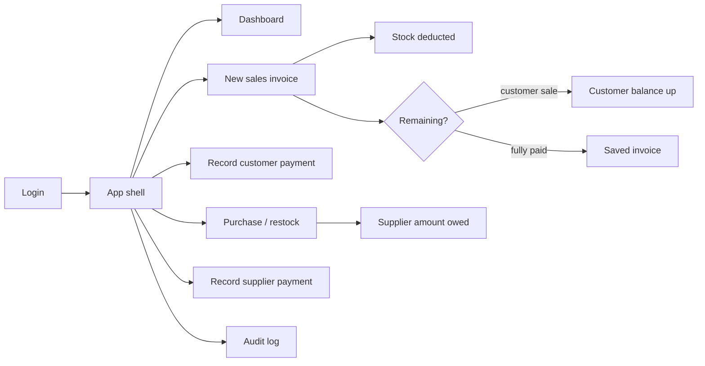

# Al-Mohamadia — Frontend (product overview)

> Internal / agent-facing product overview. The public GitHub README lives at
> [`../README.md`](../README.md).

**Wood store management** UI for a small timber shop. Shopkeepers create
sales invoices, track inventory and debt, manage customers and suppliers,
and watch daily sales — in **Arabic (RTL, default)** or **English (LTR)**,
with **light** and **dark** themes.

Product name in the UI: **Al-Mohamadia**.

Currency throughout: **EGP (ج.م)**.

---

## Business overview

The store sells wood and wood products (MDF, خشب بلدي, etc.) either **by the
piece** or **by the cubic meter** (thickness × width × length). Customers
buy in cash or on account (مديونية), paying over time. The store buys stock
from suppliers on credit and owes them until paid. The owner needs clear
visibility into today's sales/profit, outstanding debts, stock levels, and
a tamper-evident audit trail.

The UI must stay simple — the primary user is a shopkeeper, not a technical
user — with large touch targets, clear money/debt labels, and few steps to
create an invoice.

### Who uses it

| Audience | Role | What they do |
|----------|------|----------------|
| Super Admin | Account owner | Create/deactivate admin users; full operational access |
| Admin | Shop operator | Invoices, inventory, items, customers, suppliers, dashboard, audit log — **not** user management |

Access is **role-based** (`super_admin` \| `admin`). Finer permission keys
are not required for MVP.

### Domain model

```text
User (super_admin | admin)
  └── RefreshToken

Category → Item
  └── ItemPriceHistory

Customer
  ├── SalesInvoice → SalesInvoiceLine (+ Payment)
  └── Payment (standalone debt payments)

Supplier
  ├── PurchaseInvoice → PurchaseInvoiceLine (+ SupplierPayment)
  └── SupplierPayment (standalone debt payments)

AuditLog (append-only activity feed)
```

Full schema: [`../../Al-Mohamadia-Backend/docs/DATABASE.md`](../../Al-Mohamadia-Backend/docs/DATABASE.md).

### Core journeys



1. **Auth** — Login with JWT access + refresh. Post-login lands on the
   dashboard (or the first permitted route). Super admin can manage admin
   accounts; admins cannot.
2. **Sell** — Create cash or customer invoice, multi-line items (piece or
   m³), discount, paid/remaining → save / save & print → A4 PDF or A5-width PNG; share PDF via a URL-only WhatsApp message using the existing public receipt link, or share PNG through the system share sheet or WhatsApp paste/download fallback.
3. **Collect** — Record standalone payments against existing customer debt.
4. **Restock** — Purchase invoices from suppliers (dedicated creation page, view details); stock up, amount owed up.
5. **Settle** — Record standalone debt payments to suppliers.
6. **Control** — Manual جرد adjustments, low-stock flags, price history,
   read-only audit log.

> **Note:** Build is phased (vertical slices). See [`PHASES.md`](./PHASES.md)
> for what exists vs planned. **Phases 0–9 are complete** on both apps.
> Phase 10 implementation is recorded in PHASES.md; manual checks remain explicit.

---

## Capabilities (MVP)

### Sales & money

| Area | Purpose |
|------|---------|
| Sales invoices | Cash / customer sale, lines, discount, paid/remaining, cancel, PDF / WhatsApp *(Phase 4 — live)* |
| Customer payments | Standalone debt payments + payments captured on new sales, debtor customer picker *(Phase 5 — live)* |
| Dashboard | Today's sales / gross profit / estimated net profit / collected / invoice count, debt totals, selected-period sales and profit, period chart, top items, "فاتورة جديدة" *(Phase 8 — live)* |
| Operating expenses | Finance sidebar ledger with Cairo period, category, method and search filters; category management and audited edit/soft delete actions |

### Stock & catalog

| Area | Purpose |
|------|---------|
| Items & pricing | Categories, items, per-piece / per-m³, cost & unit price, price history *(Phase 2 — live; prices and costs are updated through item forms)* |
| Inventory | Stock list, low/negative stock flags, manual جرد, inventory valuation at cost & selling *(Phase 7 — live)* |
| Purchases | Restock invoices from suppliers; page-based creation and view-only detail *(Phase 6 — live)* |
| Supplier payments | Standalone debt payments to suppliers + payments captured on purchases, debtor supplier picker *(Phase 6 — live)* |

### People & trust

| Area | Purpose |
|------|---------|
| Customers | CRUD, balance (مديونية), search, filter has-debt, merge duplicates |
| Suppliers | CRUD, amount owed |
| Users | Super-admin manage admins; login / logout / refresh |
| Audit log | Read-only filtered trail of sensitive actions |

### Cross-cutting

| Concern | Behavior |
|---------|----------|
| Language | `ar` (RTL, default) and `en` (LTR), switchable from the user menu; unprefixed visits always use Arabic |
| Theme | Light & dark via tokens in [`DESIGN-SYSTEM.md`](./DESIGN-SYSTEM.md) |
| Soft delete | Master data soft-deleted; history/audit append-only |

---

## Architecture (frontend)

```text
app/[locale]/…/page.tsx     → thin URL routes (params/locale setup and feature-page composition)
app/modules/{domain}/       → feature code (UI, hooks, services)
app/layout/                 → App shell, sidebar and user menu
lib/                        → API client, auth helpers, env
messages/                   → i18n dictionaries (ar / en)
```

Locale routing uses `/ar` and `/en` prefixes. Automatic locale detection is
disabled; unprefixed visits select Arabic even with English browser preferences.
`dir` on `<html>` always follows locale (`ar` → `rtl`, `en` → `ltr`).

Feature domains: `auth`, `dashboard`, `invoices`, `payments`, `supplier-payments`,
`inventory`, `items`, `customers`, `suppliers`, `purchases`, `operating-expenses`, `audit`, `shared`.

### 3-Hub Navigation Structure

The admin shell organizes primary navigation into 3 domain hubs with horizontal in-page tabs (`HubTabs`):

1. **Sales & Customers** (`/invoices`, `/customers`, `/payments`)
2. **Purchases & Suppliers** (`/purchases`, `/suppliers`, `/supplier-payments`)
3. **Inventory & Catalog** (`/inventory`, `/items`, `/categories`)

Direct top-level routes: **Home / Dashboard** (`/`), **Finance / Operating expenses** (`/operating-expenses`), **Audit log** (`/audit`), **Users** (`/users`).
Detail views (`/customers/[id]`, `/suppliers/[id]`) accept `?from=...` to contextually route the "Back to list" action back to the user's originating list.

- **HTTP:** native `fetch` via a shared client under `lib/api/` — Bearer
  access token, refresh on 401, base URL from `NEXT_PUBLIC_API_URL`.
- **Theme:** CSS variables from [`DESIGN-SYSTEM.md`](./DESIGN-SYSTEM.md) + `.dark`.
- **Engineering rules for agents and contributors:** see
  [`AGENTS.md`](../AGENTS.md).

---

## Stack

- Next.js 16 (App Router), React 19, TypeScript
- Tailwind CSS v4
- Native `fetch` API client (no Axios / React Query unless explicitly added)
- i18n: Arabic + English; theme: light + dark

Scripts: `npm run start:dev`, `build`, `start`, `lint`, `check:architecture`,
`test:architecture`, `test:forms` (alias: `test:dimensions`).

---

## Getting started

### Prerequisites

- Node.js suitable for Next.js 16
- Running [Al-Mohamadia-Backend](../../Al-Mohamadia-Backend) API (default
  `http://localhost:3000`)

### Environment

```bash
cp .env.example .env.local
```

```env
NEXT_PUBLIC_API_URL=http://localhost:3000/api/v1
```

Use `http://` for local development. `https://localhost` will fail without
a local TLS certificate.

Ask your team for seeded users (Phase 1+). Do not commit credentials.

### Develop

The backend commonly uses port `3000`. Run the frontend on another port if
needed:

```bash
npm install
npm run start:dev
```

Open [http://localhost:3001](http://localhost:3001).

### Scripts

| Script | Command |
|--------|---------|
| Dev | `npm run start:dev` |
| Build | `npm run build` |
| Start | `npm run start` |
| Lint | `npm run lint` |

---

## Auth integration (summary)

Implemented since Phase 1 (see [`PHASES.md`](./PHASES.md)):

- **Access token** — used as Bearer on API requests via the shared client.
- **Refresh** — rotation via refresh token; client refreshes on 401 with a
  single-flight lock.
- **Logout** — clears session and returns to login.
- **Protected routes** — unauthenticated users → login; `super_admin`-only
  UI for manage-admins; admins see all operational modules, not user
  management.
- **API is the authority** — hiding a nav item is not security; the backend
  enforces roles.

### Manual verification (authentication)

1. Log in as seeded super admin.
2. Create an admin → log in as that admin → confirm no user-management UI/API.
3. Reload after access token expiry → session restores via refresh.
4. Logout → login screen; protected routes redirect when logged out.

### Manual verification (Phase 2 — UI)

After `npm run seed:catalog` in the backend repo:

1. Open **Categories** — list loads; create/edit via modal; delete disabled when items exist.
2. Open **Items & Prices** — categories/items load; search and filter work.
3. **Add item** / **Edit** via localized `/items/new` and `/items/[id]/edit` pages; change selling price or cost.
4. Open **Price history** from the row menu — change appears in the modal.
5. **Delete** item with confirmation; list refreshes.
6. On **Users** (super admin): edit / deactivate / delete via row menu + confirms.

API route table: [Backend PHASES.md — Phase 2](../../Al-Mohamadia-Backend/docs/PHASES.md#phase-2--categories-items--pricing).

### Manual verification (Phase 8 — Dashboard)

1. Log in → Home `/` shows the dashboard (not the old Foundation health page).
2. Today KPIs and debt KPI match invoices/payments/customer balances for Cairo today.
3. Change period (day/week/month/year/custom) and date range → chart buckets and top sellers update; today/debt stay the same.
4. **New Invoice** (page header) opens `/invoices/new`.
5. Debt strip **View debtors** opens Customers with the Has debt filter selected (`?hasDebt=1`).
6. Top seller rows go to `/items`; an empty period shows EmptyState for the list (flat chart is OK).
7. Check `en` / `ar` and light / dark.

API: [Backend PHASES.md — Phase 8](../../Al-Mohamadia-Backend/docs/PHASES.md#phase-8--dashboard).

---

## Invoice form and filter behavior

Invoice filters keep the last successful table and total visible during refresh, with an Updating indicator. Row actions and pagination are disabled until the selected filters load successfully. Refresh failures retain the previous results with a retry message; aborted requests cannot overwrite newer results.

Sales create/edit and purchase create use compact desktop line rows, a second row for meter dimensions, and one dashed Add line button below the rows. Controls stack on mobile and keep 44px touch targets.

## Related repositories

| Repo | Role |
|------|------|
| [Al-Mohamadia-Backend](../../Al-Mohamadia-Backend) | NestJS API, MongoDB schema, JWT auth, business rules |

---

## Docs for contributors / AI agents

| Doc | Purpose |
|-----|---------|
| [`AGENTS.md`](../AGENTS.md) | Engineering standards, folder structure, security, UX |
| [`DESIGN-SYSTEM.md`](./DESIGN-SYSTEM.md) | Quiet Ledger design system — tokens, typography, UX rules |
| [`UI/`](../UI/) | Screen mockups — **layout/structure** source of truth (re-skin with DESIGN-SYSTEM.md) |
| [`PHASES.md`](./PHASES.md) | Phased build plan and status |
| [`../../Al-Mohamadia-Backend/docs/DATABASE.md`](../../Al-Mohamadia-Backend/docs/DATABASE.md) | Data model source of truth |
| [`../README.md`](../README.md) | Public GitHub project README |


### Optional phones and item dimension presets

Customer/supplier phones are nullable and optional in forms and API types.
Blank changed input sends `null`; unchanged phones are omitted from edit requests,
preserving legacy values. New/changed phones must be Egyptian mobiles starting
with 010/011/012/015 (11 local digits), or the equivalent +20 form. Landlines and
0020 input are rejected. Merge dialogs offer an explicit phone
override checkbox; unchecked preserves the target phone, checked with blank
input clears it. Missing phones are omitted from selector subtitles and shown
as a dash in list/details.

Items store `dimensionDefaults: { thickness: number[], width: number[], length: number[] }`
in meters. Creation/editing supports multiple values per axis, validates positive
finite numbers, and deduplicates/sorts numerically. Invoice selection fills a
single preset, leaves multiple presets for an editable choice, and resets fields
when selecting another item. Invoice editing keeps saved dimensions.

Both piece and cubic lines show dimensions. Piece dimensions are optional and do
not affect quantity-based totals/stock; cubic dimensions remain required.
Snapshots are server-controlled and returned as `pricingModeSnapshot`; legacy
responses infer the old mode. No database migration is included.


## Architecture maintenance

Root `AGENTS.md` contains the complete agent instructions; this repository has one instruction file.
Named contracts live in feature `types/`, pure transformations and query builders
in `utils/`, and application/React orchestration remains in services/hooks.
Shared ownership is established by real cross-feature callers, not anticipated reuse.

Run `npm run check:architecture` and `npm run test:architecture` for placement
checks and their regression tests. The check also runs automatically before
`npm run build`. It uses the existing TypeScript AST parser and does not add a
dependency or change runtime behavior. Diagnostics identify file, line, rule,
and destination. These focused checks complement code review; they do not prove
all business logic or ownership decisions correct.

### Saved dimension choices from invoices

Sales create/edit and purchase create offer a dropdown for every dimension, including empty and single presets. The final Add value action saves a positive meter value for future invoices through POST /items/:id/dimension-defaults; custom typing stays local. Successful additions select the current value and merge sorted choices across the form. Late responses cannot update switched or removed lines.

Inventory retains eight columns and its existing actions inside compact category tables. Counts describe the loaded page. See [the current workflow checklist](#manual-verification-current-workflows).

## Current export, loading and expense flows

Invoice editing uses `/invoices/:id/edit`; Save opens details and Save & Print opens `/invoices/:id/export`. Export starts with PNG A5, with PDF A4, price visibility, print and download controls. PNG sharing uses supported browser file sharing or copy/download fallback; PDF sharing sends the public receipt link. Format-specific yellow print guidance stays outside the exported receipt. Public URLs use the Arabic PDF guidance and standard primary/outline buttons.

Route/auth loading uses shared loading surfaces. Localized/global fallback pages cover errors and unknown routes. Shared numeric inputs prevent mouse-wheel value changes while focused.

Operating expenses are already-paid entries with category management, date/method/category/search filtering, paginated rows and full-filter active summaries. Dashboard figures show paid expenses and estimated net profit for today and the selected period. Recurring dues and email reminders are planned only; see [the proposed design](../../Al-Mohamadia-Backend/docs/PHASES.md#planned-recurring-operating-expenses).

## Row navigation and invoice presentation

Both sales/purchase sidebar hubs open invoices first. Customer, supplier and sales/purchase invoice row clicks open details, with primary-link brown hover across the row and independent nested actions. Operating expenses retain modal details and share a stable localized date-only formatter. Invoice details use one labeled Previous/Next pair with an Invoice number /
Same customer selector; selected mode is carried in neighbor URLs. Receipts calculate cubic per-piece display from saved meter volume/rate; rates and stored totals stay unchanged. See [the current workflow checklist](#manual-verification-current-workflows).


### Mobile validation and invoice presentation

Invoice details use one Previous/Next pair with an Invoice number / Same customer selector. Export guidance follows PDF A4 / PNG A5 without appearing in outputs. Customer/supplier forms use a fixed Egypt +20 field with a ten-digit limit. Validation is submit-triggered, and generic `1XX XXX XXXX` guidance remains
visible at unfilled positions. See [the current workflow checklist](#manual-verification-current-workflows).


## Manual verification (current workflows)

Visual and interaction checks are user-run; agents do not access the frontend in
a browser unless explicitly requested. Automated checks do not prove visual
layout, printer settings or browser sharing behavior.

1. Open an unprefixed URL with English browser preferences: Arabic/RTL opens.
   Explicit `/en` remains English/LTR. Switch language/theme from the user menu
   and check both languages, dark/light themes and mobile layout.
2. Create multiple customers/suppliers without phones; edit/clear phones and
   preserve unchanged legacy values. Enter/paste local and +20 mobiles; check
   generic guidance, spacing, caret editing and the ten-digit input limit.
   Invalid phones should show a field error only after Submit; editing clears it.
3. Check inventory category counts, collapse, horizontal scrolling, eight columns,
   stock history/adjustment actions, KPI cards, and item creation/edit pages.
   Stock-correction presets use wording about an incorrectly recorded quantity.
4. Verify single/multiple/empty dimension presets, inline Add value, retry and
   custom typing. Check piece/cubic totals, invoice editing and saved dimensions.
5. Click customer/supplier/invoice rows and nested menus/links independently.
   Switch invoice navigation mode and follow several Previous/Next links,
   including boundaries, cash and cancelled invoices; check RTL arrow direction.
6. In Finance, choose Custom: From/To stay beside visible period buttons on
   desktop and stack on mobile. Switch back to a preset. Expense date stays
   date-only and is not combined with the record creation time.
7. Verify public/preview/print/PDF A4/PNG A5 cubic per-piece prices and unchanged
   totals, price hiding, sharing and Save & Print. Yellow print guidance must
   appear on screen and remain absent from printed/downloaded receipts.

Run `npm run test:forms`, architecture checks, TypeScript and the production
build for automated verification. Backend API regressions cover persisted
pricing, stock reversal and validation. No data reset or migration is required
for these UI checks.
