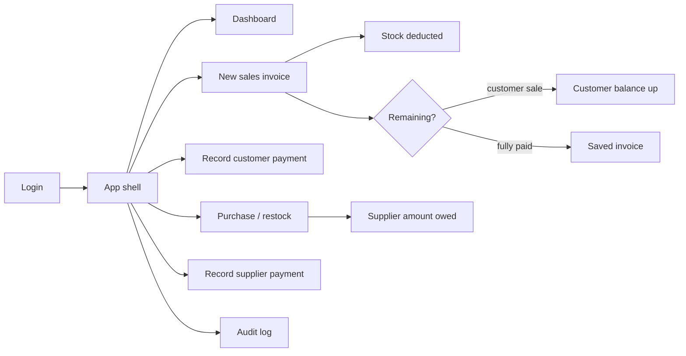

# Al-Mohamadia — Frontend (product overview)

> Internal / agent-facing product overview. The public GitHub README lives at
> [`../README.md`](../README.md).

**Wood store management** UI for a small timber shop. Shopkeepers create
sales invoices, track inventory and debt, manage customers and suppliers,
and watch daily sales — in **Arabic (RTL, default)** or **English (LTR)**,
with **light** and **dark** themes.

Product name in the UI: **Al-Mohamadia**.

Currency throughout: **EGP (ج.م)**.

---

## Business overview

The store sells wood and wood products (MDF, خشب بلدي, etc.) either **by the
piece** or **by the cubic meter** (thickness × width × length). Customers
buy in cash or on account (مديونية), paying over time. The store buys stock
from suppliers on credit and owes them until paid. The owner needs clear
visibility into today's sales/profit, outstanding debts, stock levels, and
a tamper-evident audit trail.

The UI must stay simple — the primary user is a shopkeeper, not a technical
user — with large touch targets, clear money/debt labels, and few steps to
create an invoice.

### Who uses it

| Audience | Role | What they do |
|----------|------|----------------|
| Super Admin | Account owner | Create/deactivate admin users; full operational access |
| Admin | Shop operator | Invoices, inventory, items, customers, suppliers, dashboard, audit log — **not** user management |

Access is **role-based** (`super_admin` \| `admin`). Finer permission keys
are not required for MVP.

### Domain model

```text
User (super_admin | admin)
  └── RefreshToken

Category → Item
  └── ItemPriceHistory

Customer
  ├── SalesInvoice → SalesInvoiceLine (+ Payment)
  └── Payment (standalone debt payments)

Supplier
  ├── PurchaseInvoice → PurchaseInvoiceLine (+ SupplierPayment)
  └── SupplierPayment (standalone debt payments)

AuditLog (append-only activity feed)
```

Full schema: [`../../Al-Mohamadia-Backend/docs/DATABASE.md`](../../Al-Mohamadia-Backend/docs/DATABASE.md).

### Core journeys



1. **Auth** — Login with JWT access + refresh. Post-login lands on the
   dashboard (or the first permitted route). Super admin can manage admin
   accounts; admins cannot.
2. **Sell** — Create cash or customer invoice, multi-line items (piece, m³, or مبلغ حر amount), discount, paid/remaining → save / save & print → A4 PDF or A5-width PNG; share PDF via a URL-only WhatsApp message using the existing public receipt link, or share PNG through the system share sheet or WhatsApp paste/download fallback.
3. **Collect** — Record standalone customer payments for debt settlement or advance credit, at any current balance.
4. **Restock** — Create/edit purchase invoices on dedicated pages; reconcile stock, supplier debt, and the invoice payment.
5. **Settle** — Record standalone supplier payments, including advance credit.
6. **Control** — Manual جرد adjustments, low-stock flags, price history,
   read-only audit log.

> **Note:** Build is phased (vertical slices). See [`PHASES.md`](./PHASES.md)
> for what exists vs planned. **Phases 0–9 are complete** on both apps.
> Phase 10 implementation is recorded in PHASES.md; manual checks remain explicit.

---

## Capabilities (MVP)

### Sales & money

| Area | Purpose |
|------|---------|
| Sales invoices | Cash / customer sale, lines, discount, paid/remaining, cancel, PDF / WhatsApp *(Phase 4 — live)* |
| Customer payments | Standalone debt/advance payments + payments captured on sales create/edit, active customer picker *(Phase 5 — live)* |
| Dashboard | Today's sales / gross profit / collected / invoice count, debt totals, selected-period sales and gross profit, period chart, top items, "فاتورة جديدة" *(Phase 8 — live)* |

### Stock & catalog

| Area | Purpose |
|------|---------|
| Items & pricing | Categories, items, per-piece / per-m³ / مبلغ حر; cost, unit price and price history for stocked items *(Phase 2 — live)* |
| Inventory | Stock list, low/negative stock flags, manual جرد, inventory valuation at cost & selling *(Phase 7 — live)* |
| Purchases | Restock invoices from suppliers; dedicated create/edit pages and detail *(Phase 6 — live)* |
| Supplier payments | Standalone debt/advance payments + payments captured on purchases, active supplier picker *(Phase 6 — live)* |

### People & trust

| Area | Purpose |
|------|---------|
| Customers | CRUD, balance (مديونية), search, filter has-debt, merge duplicates |
| Suppliers | CRUD, amount owed |
| Users | Super-admin manage admins; login / logout / refresh |
| Audit log | Read-only filtered trail of sensitive actions |

### Cross-cutting

| Concern | Behavior |
|---------|----------|
| Language | `ar` (RTL, default) and `en` (LTR), switchable from the user menu; unprefixed visits always use Arabic |
| Theme | Light & dark via tokens in [`DESIGN-SYSTEM.md`](./DESIGN-SYSTEM.md) |
| Soft delete | Master data soft-deleted; history/audit append-only |

---

## Architecture (frontend)

```text
app/[locale]/…/page.tsx     → thin URL routes (params/locale setup and feature-page composition)
app/modules/{domain}/       → feature code (UI, hooks, services)
app/layout/                 → App shell, sidebar and user menu
lib/                        → API client, auth helpers, env
messages/                   → i18n dictionaries (ar / en)
```

Locale routing uses `/ar` and `/en` prefixes. Automatic locale detection is
disabled; unprefixed visits select Arabic even with English browser preferences.
`dir` on `<html>` always follows locale (`ar` → `rtl`, `en` → `ltr`).

Feature domains: `auth`, `dashboard`, `invoices`, `payments`, `supplier-payments`,
`inventory`, `items`, `customers`, `suppliers`, `purchases`, `audit`, `shared`.

### 3-Hub Navigation Structure

The admin shell organizes primary navigation into 3 domain hubs with horizontal in-page tabs (`HubTabs`):

1. **Sales & Customers** (`/invoices`, `/customers`, `/payments`)
2. **Purchases & Suppliers** (`/purchases`, `/suppliers`, `/supplier-payments`)
3. **Inventory & Catalog** (`/inventory`, `/items`, `/categories`)

Direct top-level routes: **Home / Dashboard** (`/`), **Audit log** (`/audit`), **Users** (`/users`).
Detail views (`/customers/[id]`, `/suppliers/[id]`) accept `?from=...` to contextually route the "Back to list" action back to the user's originating list.

- **HTTP:** native `fetch` via a shared client under `lib/api/` — Bearer
  access token, refresh on 401, base URL from `NEXT_PUBLIC_API_URL`.
- **Theme:** CSS variables from [`DESIGN-SYSTEM.md`](./DESIGN-SYSTEM.md) + `.dark`.
- **Engineering rules for agents and contributors:** see
  [`AGENTS.md`](../AGENTS.md).

---

## Stack

- Next.js 16 (App Router), React 19, TypeScript
- Tailwind CSS v4
- Native `fetch` API client (no Axios / React Query unless explicitly added)
- i18n: Arabic + English; theme: light + dark

Scripts: `npm run start:dev`, `build`, `start`, `lint`, `check:architecture`,
`test:architecture`, `test:forms` (alias: `test:dimensions`).

---

## Getting started

### Prerequisites

- Node.js suitable for Next.js 16
- Running [Al-Mohamadia-Backend](../../Al-Mohamadia-Backend) API (default
  `http://localhost:3000`)

### Environment

```bash
cp .env.example .env.local
```

```env
NEXT_PUBLIC_API_URL=http://localhost:3000/api/v1
```

Use `http://` for local development. `https://localhost` will fail without
a local TLS certificate.

Ask your team for provisioned user accounts. Do not commit credentials.

### Develop

The backend commonly uses port `3000`. Run the frontend on another port if
needed:

```bash
npm install
npm run start:dev
```

Open [http://localhost:3001](http://localhost:3001).

### Scripts

| Script | Command |
|--------|---------|
| Dev | `npm run start:dev` |
| Build | `npm run build` |
| Start | `npm run start` |
| Lint | `npm run lint` |

---

## Auth integration (summary)

Implemented since Phase 1 (see [`PHASES.md`](./PHASES.md)):

- **Access token** — used as Bearer on API requests via the shared client.
- **Refresh** — rotation via refresh token; client refreshes on 401 with a
  single-flight lock.
- **Logout** — clears session and returns to login.
- **Protected routes** — unauthenticated users → login; `super_admin`-only
  UI for manage-admins; admins see all operational modules, not user
  management.
- **API is the authority** — hiding a nav item is not security; the backend
  enforces roles.

### Manual verification (authentication)

1. Log in with a provisioned super-admin account.
2. Create an admin → log in as that admin → confirm no user-management UI/API.
3. Reload after access token expiry → session restores via refresh.
4. Logout → login screen; protected routes redirect when logged out.

### Manual verification (Phase 2 — UI)

Using development examples created through the application/API:

1. Open **Categories** — list loads; create/edit via modal; delete disabled when items exist.
2. Open **Items & Prices** — categories/items load; search and filter work.
3. **Add item** / **Edit** via localized `/items/new` and `/items/[id]/edit` pages; change selling price or cost.
4. Open **Price history** from the row menu — change appears in the modal.
5. **Delete** item with confirmation; list refreshes.
6. On **Users** (super admin): edit / deactivate / delete via row menu + confirms.

API route table: [Backend PHASES.md — Phase 2](../../Al-Mohamadia-Backend/docs/PHASES.md#phase-2--categories-items--pricing).

### Manual verification (Phase 8 — Dashboard)

1. Log in → Home `/` shows the dashboard (not the old Foundation health page).
2. Today KPIs and debt KPI match invoices/payments/customer balances for Cairo today.
3. Change period (day/week/month/year/custom) and date range → chart buckets and top sellers update; today/debt stay the same.
4. **New Invoice** (page header) opens `/invoices/new`.
5. Debt strip **View debtors** opens Customers with the Has debt filter selected (`?hasDebt=1`).
6. Top seller rows go to `/items`; an empty period shows EmptyState for the list (flat chart is OK).
7. Check `en` / `ar` and light / dark.

API: [Backend PHASES.md — Phase 8](../../Al-Mohamadia-Backend/docs/PHASES.md#phase-8--dashboard).

---

## Invoice form and filter behavior

Invoice filters keep the last successful table and total visible during refresh, with an Updating indicator. Row actions and pagination are disabled until the selected filters load successfully. Refresh failures retain the previous results with a retry message; aborted requests cannot overwrite newer results.

Sales and purchase create/edit use compact desktop line rows, a second row for meter dimensions, and one dashed Add line button below the rows. Controls stack on mobile and keep 44px touch targets.

## Related repositories

| Repo | Role |
|------|------|
| [Al-Mohamadia-Backend](../../Al-Mohamadia-Backend) | NestJS API, MongoDB schema, JWT auth, business rules |

---

## Docs for contributors / AI agents

| Doc | Purpose |
|-----|---------|
| [`AGENTS.md`](../AGENTS.md) | Engineering standards, folder structure, security, UX |
| [`DESIGN-SYSTEM.md`](./DESIGN-SYSTEM.md) | Quiet Ledger design system — tokens, typography, UX rules |
| [`PHASES.md`](./PHASES.md) | Phased build plan and status |
| [`../../Al-Mohamadia-Backend/docs/DATABASE.md`](../../Al-Mohamadia-Backend/docs/DATABASE.md) | Data model source of truth |
| [`../README.md`](../README.md) | Public GitHub project README |


### Optional phones and item dimension presets

Customer/supplier phones are nullable and optional in forms and API types.
Blank changed input sends `null`; unchanged phones are omitted from edit requests,
preserving legacy values. New/changed phones must be Egyptian mobiles starting
with 010/011/012/015 (11 local digits), or the equivalent +20 form. Landlines and
0020 input are rejected. Merge dialogs offer an explicit phone
override checkbox; unchecked preserves the target phone, checked with blank
input clears it. Customer search choices show names only; supplier selectors may include contact data. Missing phones display as a dash in list contact columns. Customer/supplier detail pages omit contact displays while Edit preserves contact management.

Items store `dimensionDefaults: { thickness: number[], width: number[], length: number[] }`
in meters. Creation/editing supports multiple values per axis, validates positive
finite numbers, and deduplicates/sorts numerically. Invoice selection fills a
single preset, leaves multiple presets for an editable choice, and resets fields
when selecting another item. Invoice editing keeps saved dimensions.

Both piece and cubic lines show dimensions. Piece dimensions are optional and do
not affect quantity-based totals/stock; cubic dimensions remain required.
Snapshots are server-controlled and returned as `pricingModeSnapshot`; legacy
responses infer the old mode. No database migration is included.

`free_amount` (مبلغ حر) items are chosen in the sales item picker and show one
required positive EGP amount plus an optional note. The form hides quantity,
dimensions, and unit price. The server stores canonical quantity 1 and the amount
as `piecePrice`, with zero cost and no stock movement. Preview/export leave those
internal columns blank, while including the charge in the invoice total. Physical
quantity and cubic footer totals exclude free-amount lines. Purchase forms also
accept these items as one positive amount and optional note, storing quantity 1,
`unitCost: amount`, and no dimensions. Inventory still excludes them. Saved
free-amount purchase totals reduce the existing gross-profit figures in their
purchase creation period, independently of sales dates and supplier payments.
Gross profit is net sales minus stocked-item sales costs and those purchase
totals; cancelled purchases are excluded and negative profit is retained.

Sales and purchase forms share searchable account and categorized item pickers.
Customer sale appears first and remains the default. On sales forms, Save & print
is primary, Save is outlined, and Go back is a quiet action. Searchable selections
preserve keyboard navigation and show the existing account summary after selection.


## Architecture maintenance

Root `AGENTS.md` contains the complete agent instructions; this repository has one instruction file.
Named contracts live in feature `types/`, pure transformations and query builders
in `utils/`, and application/React orchestration remains in services/hooks.
Shared ownership is established by real cross-feature callers, not anticipated reuse.

Run `npm run check:architecture` and `npm run test:architecture` for placement
checks and their regression tests. The check also runs automatically before
`npm run build`. It uses the existing TypeScript AST parser and does not add a
dependency or change runtime behavior. Diagnostics identify file, line, rule,
and destination. These focused checks complement code review; they do not prove
all business logic or ownership decisions correct.

### Saved dimension choices from invoices

Sales and purchase create/edit offer a dropdown for every dimension, including empty and single presets. The final Add value action saves a positive meter value for future invoices through POST /items/:id/dimension-defaults; custom typing stays local. Successful additions select the current value and merge sorted choices across the form. Late responses cannot update switched or removed lines.

Inventory retains eight columns and its existing actions inside compact category tables. Pagination requests five complete matching categories per page through `paginationMode=categories&limit=5`; category groups follow category creation date ascending (oldest first, ID ties), and a large category stays on one longer page. Search and stock-status filters apply before choosing categories. Counts describe the loaded page; page totals count matching categories, while KPI calculations remain unchanged. Collapse all and Expand all apply across inventory pagination during the current page visit. Individual category toggles are retained across pages as overrides; either global action clears those overrides.

## Current export and loading flows

Sales editing uses `/invoices/:id/edit` with Save Changes and a back link to the invoices list; sales creation retains Save & Print to open `/invoices/:id/export`. Purchase editing uses `/purchases/:id/edit`, reconciles stock, supplier debt and its linked payment, and leaves standalone older-debt payments with their original supplier. Export starts with PNG A5, with PDF A4, price visibility, print and download controls. PNG sharing uses supported browser file sharing or copy/download fallback; PDF sharing sends the public receipt link. Format-specific yellow print guidance stays outside the exported receipt. Public URLs use the Arabic PDF guidance and standard primary/outline buttons.

Route/auth loading uses shared loading surfaces. Localized/global fallback pages cover errors and unknown routes. Shared numeric inputs prevent mouse-wheel value changes while focused.

The operating-expense feature is retired. The backend retains historical expense audit entries. No cleanup command is shipped; existing expense/category collections remain untouched unless a separate maintenance operation is reviewed and explicitly run.

## Row navigation and invoice presentation

Both sales/purchase sidebar hubs open invoices first. Customer, supplier and sales/purchase invoice row clicks open details, with primary-link brown hover across the row and independent nested actions. Invoice details use one labeled Previous/Next pair with an Invoice number /
Same customer selector; selected mode is carried in neighbor URLs. Receipts calculate cubic per-piece display from saved meter volume/rate; rates and stored totals stay unchanged.


### Mobile validation and invoice presentation

Invoice details use one Previous/Next pair with an Invoice number / Same customer selector. Export guidance follows PDF A4 / PNG A5 without appearing in outputs. Customer/supplier forms use a fixed Egypt +20 field with a ten-digit limit. Validation is submit-triggered, and generic `1XX XXX XXXX` guidance remains
visible at unfilled positions.


## Manual verification (current workflows)

Visual and interaction checks are user-run; agents do not access the frontend in
a browser unless explicitly requested. Automated checks do not prove visual
layout, printer settings or browser sharing behavior.

1. Open an unprefixed URL with English browser preferences: Arabic/RTL opens.
   Explicit `/en` remains English/LTR. Switch language/theme from the user menu
   and check both languages, dark/light themes and mobile layout.
2. Create multiple customers/suppliers without phones; edit/clear phones and
   preserve unchanged legacy values. Enter/paste local and +20 mobiles; check
   generic guidance, spacing, caret editing and the ten-digit input limit.
   Invalid phones should show a field error only after Submit; editing clears it.
3. Check inventory category counts, collapse, horizontal scrolling, eight columns,
   stock history/adjustment actions, KPI cards, and item creation/edit pages.
   With more than five categories, confirm that each page shows complete matching
   groups, including a category with more than 25 items. Repeat with search, each
   stock-status filter, a single category, and empty results; check category page labels.
   Stock-correction presets use wording about an incorrectly recorded quantity.
4. Verify single/multiple/empty dimension presets, inline Add value, retry and
   custom typing. Check piece/cubic totals, invoice editing and saved dimensions.
5. Click customer/supplier/invoice rows and nested menus/links independently.
   Switch invoice navigation mode and follow several Previous/Next links,
   including boundaries, cash and cancelled invoices; check RTL arrow direction.
6. Verify public/preview/print/PDF A4/PNG A5 cubic per-piece prices and unchanged
   totals, price hiding, sharing and Save & Print. Yellow print guidance must
   appear on screen and remain absent from printed/downloaded receipts.
7. Create a مبلغ حر item and a mixed sales invoice. Check amount-only fields,
   no inventory movement, blank quantity/dimension/unit-price receipt cells,
   physical-only quantity/cubic totals, and matching Arabic/English previews.

Run `npm run test:forms`, architecture checks, TypeScript and the production
build for automated verification. Backend API regressions cover persisted
pricing, stock reversal and validation. No data reset or migration is required
for these UI checks.


### Account balance and payment workflow

Customer/supplier detail pages show three KPIs: lifetime net invoice totals, active payments, and signed current balance, followed by separate invoice and payment histories. Create accepts an optional starting Balance. Edit shows the actual current Balance and saves an intentional correction directly, with old/new amounts and the difference recorded automatically in the same transaction. Corrections do not change invoices, payments, or their totals. Negative balances represent credit. There is no separate opening balance, legacy derivation, migration, or backfill; existing database records are untouched.

Invoice creation and editing expose one **Paid amount** field. The form caps the invoice payment at net, keeps remaining at zero when overpaid, and automatically records the difference as an additional account payment, explained inline. The resulting account debt/credit preview remains visible. Saved invoice details, modal, print/PDF and public receipt show the combined paid total and, when an origin-linked extra exists, a parenthesized invoice-plus-previous-debt breakdown; the additional amount reduces account debt or creates advance credit. It is recorded in payment history and remains active if that invoice is edited, reassigned, or cancelled. Cancel it separately when necessary. Standalone payments can also create credit. Existing credit offsets future account debt without changing individual invoice settlement.

Sales creation defaults to Customer Sale, with a single searchable customer selection field rather than separate search and select controls.


Additional account payments now retain source-invoice provenance (`Payment.sourceInvoiceId`, `SupplierPayment.sourcePurchaseInvoiceId`) separately from lifecycle links. Invoice/public responses expose active same-party `accountPaymentAmount`; the UI combines it with invoice `paid` for display only. Earlier payments without provenance are not inferred or backfilled from matching timestamps/amounts. Selected customers use the same muted summary panel as suppliers and a Change customer action to reopen the single search dropdown.

### Sales selection and name-only customer lookup

Customer searches on sales creation, customer management, and customer payments match names only. The shared customer API no longer searches phone numbers; contact editing is unchanged. Sales item rows now have one searchable combobox matching item or category names, with category headings grouping their items and keyboard selection. Paid amount comes before Discount in locale reading order.

Manual checks (English/Arabic, light/dark, desktop/mobile): search customers by name and confirm a phone-only query does not match; search items by item/category, choose using mouse/touch or arrows/Enter, check category headings, no-results and Escape/blur, and confirm reopening or reselecting the same item preserves the line price/dimensions. Verify the swapped Paid/Discount order and unchanged overpayment calculation. Browser verification remains user-run.

### Bundled production fonts

`app/fonts.ts` loads the bundled Noto Sans Arabic / Noto Sans variable WOFF2 files through `next/font/local`, preserving both CSS variables and weights 400–700. Builds do not fetch Google Fonts. Include `app/font-files/` and its license notices when committing or uploading for Vercel/Docker. Asset provenance is documented in [the font README](../app/font-files/README.md).

### Receipt label width and Arabic note verification

Sales receipt preview, public receipts, PNG/share captures, and PDF/print use the same column policy: 25% for item names with all eight columns visible, plus reclaimed space when optional columns are hidden. Tighter numeric padding leaves room for names. Line notes reuse item-text formatting, so `4ملي` displays as `4 ملي` with isolated digits and regular note styling. The backend contracts and export utilities are unchanged.

Manual visual check (browser verification remains user-run): use invoice 9124 or equivalent six-row piece/cubic data, including `18 ام اف ساده`, `ابلاكاش 6 ملي ارو`, `2.7 ملي ته مربع`, and notes `4ملي` / `4 ملي`. Compare website preview, downloaded/shared A5 PNG, A4 PDF, and print. Confirm no overlapping number/Arabic text, ordinary names fit naturally, all numeric columns remain readable, and totals/payment breakdowns are unchanged. Repeat without prices, without dimensions, with free-amount lines, and with an exceptionally long name/note that must wrap rather than truncate.

The Items page shows a Total items KPI above its filters using the existing KPI card styling. The count includes all non-deleted catalog records (active, inactive and free-amount items) and does not change with search, category or status filters. Loading shows a skeleton; errors show an unavailable value rather than zero.

The Categories page uses the same full-width count card as Items, showing all non-deleted categories, including inactive and empty categories. Loading shows a skeleton and errors show an unavailable value.

Catalog pagination: Items shows five complete matching category groups per page after search, category and active-status filtering; a large category stays on one longer page. Categories supports case-insensitive name search and All/Active/Inactive status filters in the Items-style toolbar, then shows ten matching rows per page. Filtering resets to page one without changing the total-category KPI. Filtered empty results suggest adjusting the filters. Both use localized Previous / page counter / Next controls, hidden for a single page. Filters and catalog refreshes return to page one; KPI counts remain catalog-wide. These pages paginate the existing complete catalog responses locally; invoice selectors continue to receive the complete lists.

Items and Inventory share Close all / Expand all controls and category collapse behavior. The global choice carries across pagination and filters during the page visit, with individual category overrides. A later global action clears those overrides. Item category headers are keyboard-accessible buttons with expanded state; closed tables are hidden from interaction.

## Item identification

Items are identified by database ID and displayed by name/category. Create and update item requests do not accept `code`; item, inventory and dashboard top-selling responses do not return it. Item-name duplicates are allowed. Item forms do not fetch the complete catalog to generate identifiers. Items and Inventory search names only; invoice selectors retain item/category-name search. Historical audit code hiding remains for old audit entries. Database cleanup is a manual rollout step; no database fields or indexes are removed automatically.

