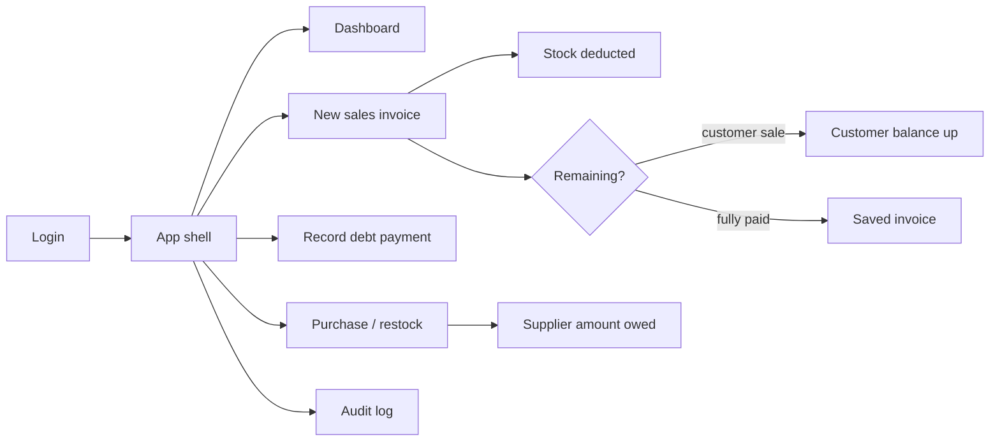

# Al-Mohamadia — Frontend (product overview)

> Internal / agent-facing product overview. The public GitHub README lives at
> [`../README.md`](../README.md).

**Wood store management** UI for a small timber shop. Shopkeepers create
sales invoices, track inventory and debt, manage customers and suppliers,
and watch daily sales — in **English (LTR, default)** or **Arabic (RTL)**,
with **light** and **dark** themes.

Product name in the UI: **Al-Mohamadia**.

Currency throughout: **EGP (ج.م)**.

---

## Business overview

The store sells wood and wood products (MDF, خشب بلدي, etc.) either **by the
piece** or **by the cubic meter** (thickness × width × length). Customers
buy in cash or on account (مديونية), paying over time. The store buys stock
from suppliers on credit and owes them until paid. The owner needs clear
visibility into today's sales/profit, outstanding debts, stock levels, and
a tamper-evident audit trail.

The UI must stay simple — the primary user is a shopkeeper, not a technical
user — with large touch targets, clear money/debt labels, and few steps to
create an invoice.

### Who uses it

| Audience | Role | What they do |
|----------|------|----------------|
| Super Admin | Account owner | Create/deactivate admin users; full operational access |
| Admin | Shop operator | Invoices, inventory, items, customers, suppliers, dashboard, audit log — **not** user management |

Access is **role-based** (`super_admin` \| `admin`). Finer permission keys
are not required for MVP.

### Domain model

```text
User (super_admin | admin)
  └── RefreshToken

Category → Item
  ├── ItemPriceHistory
  └── StockAdjustment

Customer
  ├── SalesInvoice → SalesInvoiceLine (+ Payment)
  └── Payment (standalone debt payments)

Supplier
  └── PurchaseInvoice → PurchaseInvoiceLine

AuditLog (append-only activity feed)
```

Full schema: [`../../Al-Mohamadia-Backend/docs/DATABASE.md`](../../Al-Mohamadia-Backend/docs/DATABASE.md).

### Core journeys



1. **Auth** — Login with JWT access + refresh. Post-login lands on the
   dashboard (or the first permitted route). Super admin can manage admin
   accounts; admins cannot.
2. **Sell** — Create cash or customer invoice, multi-line items (piece or
   m³), discount, paid/remaining → save / save & print → PDF / WhatsApp.
3. **Collect** — Record standalone payments against existing customer debt.
4. **Restock** — Purchase invoices from suppliers; stock up, amount owed up.
5. **Control** — Manual جرد adjustments, low-stock flags, price history,
   read-only audit log.

> **Note:** Build is phased (vertical slices). See [`PHASES.md`](./PHASES.md)
> for what exists vs planned. **Phase 2 is complete** (backend API + Items &
> Prices UI, Users polish). Phase 3 is next (Customers & Suppliers).

---

## Capabilities (MVP)

### Sales & money

| Area | Purpose |
|------|---------|
| Sales invoices | Cash / customer sale, lines, discount, paid/remaining, cancel, PDF / WhatsApp |
| Payments | Standalone debt payments + payments captured on new sales |
| Dashboard | Today's sales / profit / collected / invoice count, debt totals, monthly chart, top items, "فاتورة جديدة" |

### Stock & catalog

| Area | Purpose |
|------|---------|
| Items & pricing | Categories, items, per-piece / per-m³, cost & unit price, price history *(Phase 2 — live; base reference price API kept for later UI)* |
| Inventory | Stock list, low/negative stock flags, manual جرد, inventory value at cost |
| Purchases | Restock invoices from suppliers |

### People & trust

| Area | Purpose |
|------|---------|
| Customers | CRUD, balance (مديونية), search, filter has-debt, merge duplicates |
| Suppliers | CRUD, amount owed |
| Users | Super-admin manage admins; login / logout / refresh |
| Audit log | Read-only filtered trail of sensitive actions |

### Cross-cutting

| Concern | Behavior |
|---------|----------|
| Language | `en` (RTL, default) and `ar` (RTL), runtime switchable |
| Theme | Light & dark via tokens in [`Design-System.md`](./Design-System.md) |
| Soft delete | Master data soft-deleted; history/audit append-only |

---

## Architecture (frontend)

```text
app/[locale]/…/page.tsx     → thin URL routes (re-export only)
app/modules/{domain}/       → feature code (UI, hooks, services)
app/layout/                 → App shell, sidebar, auth guard
lib/                        → API client, auth helpers, env
messages/ or locales/       → i18n dictionaries (ar / en)
```

Exact locale routing is decided in Phase 0 — stay consistent once chosen.
`dir` on `<html>` always follows locale (`ar` → `rtl`, `en` → `ltr`).

Feature domains: `auth`, `dashboard`, `invoices`, `payments`, `inventory`,
`items`, `customers`, `suppliers`, `purchases`, `audit`, `shared`.

- **HTTP:** native `fetch` via a shared client under `lib/api/` — Bearer
  access token, refresh on 401, base URL from `NEXT_PUBLIC_API_URL`.
- **Theme:** CSS variables from [`Design-System.md`](./Design-System.md) + `.dark`.
- **Engineering rules for agents and contributors:** see
  [`AGENTS.md`](./AGENTS.md).

---

## Stack

- Next.js 16 (App Router), React 19, TypeScript
- Tailwind CSS v4
- Native `fetch` API client (no Axios / React Query unless explicitly added)
- i18n: Arabic + English; theme: light + dark

Scripts: `npm run start:dev`, `build`, `start`, `lint`.

---

## Getting started

### Prerequisites

- Node.js suitable for Next.js 16
- Running [Al-Mohamadia-Backend](../../Al-Mohamadia-Backend) API (default
  `http://localhost:3000`)

### Environment

```bash
cp .env.example .env.local
```

```env
NEXT_PUBLIC_API_URL=http://localhost:3000/api/v1
```

Use `http://` for local development. `https://localhost` will fail without
a local TLS certificate.

Ask your team for seeded users (Phase 1+). Do not commit credentials.

### Develop

The backend commonly uses port `3000`. Run the frontend on another port if
needed:

```bash
npm install
npm run start:dev -- -p 3001
```

Open [http://localhost:3001](http://localhost:3001).

### Scripts

| Script | Command |
|--------|---------|
| Dev | `npm run start:dev` |
| Build | `npm run build` |
| Start | `npm run start` |
| Lint | `npm run lint` |

---

## Auth integration (summary)

Planned from Phase 1 (see [`PHASES.md`](./PHASES.md)):

- **Access token** — used as Bearer on API requests via the shared client.
- **Refresh** — rotation via refresh token; client refreshes on 401 with a
  single-flight lock.
- **Logout** — clears session and returns to login.
- **Protected routes** — unauthenticated users → login; `super_admin`-only
  UI for manage-admins; admins see all operational modules, not user
  management.
- **API is the authority** — hiding a nav item is not security; the backend
  enforces roles.

### Manual verification (once Phase 1 is done)

1. Log in as seeded super admin.
2. Create an admin → log in as that admin → confirm no user-management UI/API.
3. Reload after access token expiry → session restores via refresh.
4. Logout → login screen; protected routes redirect when logged out.

### Manual verification (Phase 2 — UI)

After `npm run seed:catalog` in the backend repo:

1. Open **Categories** — list loads; create/edit via modal; delete disabled when items exist.
2. Open **Items & Prices** — categories/items load; search and filter work.
3. **Add item** / **Edit** via modal; change selling price or cost.
4. Open **Price history** from the row menu — change appears in the modal.
5. **Delete** item with confirmation; list refreshes.
6. On **Users** (super admin): edit / deactivate / delete via row menu + confirms.

API route table: [Backend PHASES.md — Phase 2](../../Al-Mohamadia-Backend/docs/PHASES.md#phase-2--categories-items--pricing).

---

## Related repositories

| Repo | Role |
|------|------|
| [Al-Mohamadia-Backend](../../Al-Mohamadia-Backend) | NestJS API, MongoDB schema, JWT auth, business rules |

---

## Docs for contributors / AI agents

| Doc | Purpose |
|-----|---------|
| [`AGENTS.md`](./AGENTS.md) | Engineering standards, folder structure, security, UX |
| [`Design-System.md`](./Design-System.md) | Quiet Ledger design system — tokens, typography, UX rules |
| [`UI/`](../UI/) | Screen mockups — **layout/structure** source of truth (re-skin with Design-System.md) |
| [`PHASES.md`](./PHASES.md) | Phased build plan and status |
| [`../../Al-Mohamadia-Backend/docs/DATABASE.md`](../../Al-Mohamadia-Backend/docs/DATABASE.md) | Data model source of truth |
| [`../README.md`](../README.md) | Public GitHub project README |
